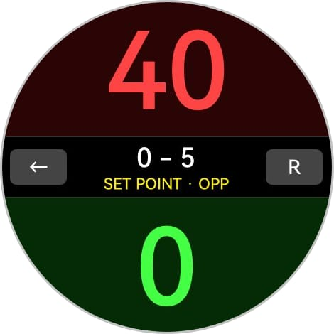
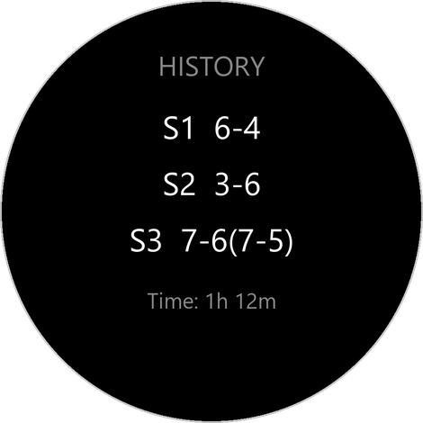
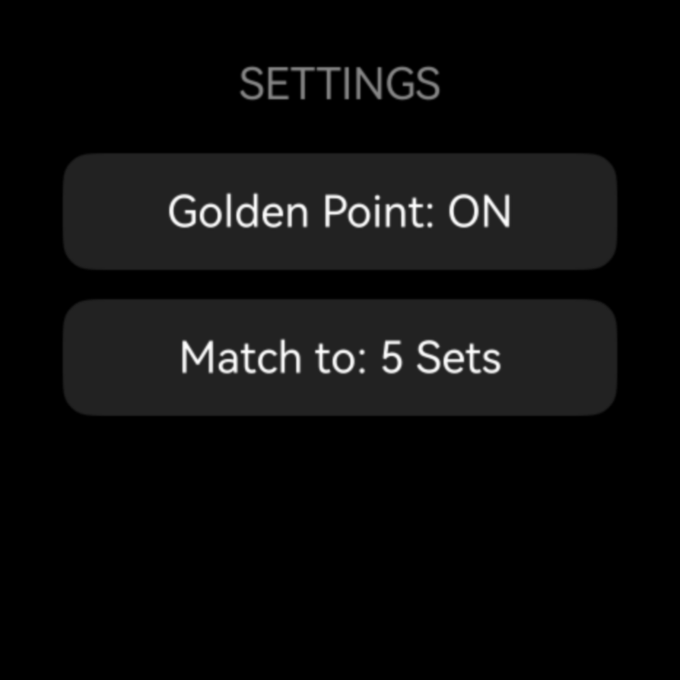

# Padel Counter per al Huawei Watch GT 6

[English](README.md) · **Català** · [Español](README.es.md)

Un marcador de pàdel per al canell. Toca la meitat de dalt quan guanyen els rivals i la de baix quan guanyes tu. Sense mòbil, sense compte i sense xarxa.

Fet per al Huawei Watch GT 6 (HarmonyOS, pantalla rodona de 466×466) amb el framework JS Lite Wearable de HarmonyOS.

  
  
  

_Les captures són de la v1.2. Des d'aleshores la barra central mostra jocs i sets en dues línies, i un punt groc marca qui serveix._

## Funcions

- **Puntuació completa de pàdel:** 0 / 15 / 30 / 40 / Ad, jocs, sets i tie-break al 6-6 (fins a 7, amb dos punts de marge).
- **Punt d'or** activat o desactivat.
- **Durada del partit:** 1, 3 o 5 sets.
- **Indicador de servei:** un punt groc mostra qui serveix. Canvia cada joc i segueix la rotació del tie-break (després del primer punt i després cada dos).
- **Desfer** els últims 3 punts. L'historial de desfer sobreviu si es tanca l'app.
- **Historial del partit** amb el resultat de cada set, amb el detall del tie-break (p. ex. `7-6(7-5)`), i la durada del partit.
- **Avís de punt de set i de partit** a la barra central, amb el costat que el pot guanyar.
- **Estalvi de bateria:** la pantalla s'atenua després de 90 segons sense tocar-la i torna a la brillantor normal en tocar-la.
- **Vibració:** una de curta en guanyar un joc i una de llarga en guanyar un set o el partit. Es pot desactivar a Ajustos.
- **Reset segur:** el botó `R` es posa vermell i demana `OK?`; un segon toc abans de 3 segons reinicia.
- **Manté la pantalla encesa** durant el partit i **desa cada punt**, així que pots continuar si el sistema tanca l'app.

Llisca cap a l'esquerra des del marcador per veure l'Historial i els Ajustos.

## Bo de saber

Si comences un entrenament a l'app Esports de Huawei, o en reps els avisos de 30 min o 1 h, el sistema pot tancar les apps de tercers. Una app de tercers no pot engegar-se sola des d'Esports ni bloquejar aquests avisos. Padel Counter desa el marcador després de cada punt, i en reobrir-la el partit torna tal com era.

## Instal·lació

No hi ha cap versió a la botiga. T'ho has de compilar i instal·lar tu:

1. Instal·la [DevEco Studio](https://developer.huawei.com/consumer/en/deveco-studio/) i obre aquesta carpeta.
2. A **File > Project Structure > Signing Configs**, genera la teva pròpia signatura de depuració (cal un compte de desenvolupador de Huawei i el rellotge registrat com a dispositiu de proves).
3. Instal·la l'app **DevEco Assistant** al mòbil i connecta-hi el rellotge. Huawei ho fa força feixuc, així que compta amb una estona.
4. Instal·la el `.hap` signat al rellotge amb DevEco Assistant: executa el projecte des de DevEco Studio, o copia el `.hap` compilat al mòbil i instal·la'l des de l'app.

Els fitxers de signatura (`.p12`, `.p7b`, `.cer`) no formen part d'aquest repositori.

## Estructura del projecte

| Fitxer | Què fa |
| --- | --- |
| `entry/src/main/js/MainAbility/pages/index/index.js` | Regles de puntuació, servei, desfer, desar i carregar |
| `.../index.hml` | Disseny: marcador, historial i ajustos |
| `.../index.css` | Estils per a la pantalla rodona de 466×466 |
| `entry/src/main/config.json` | Nom del paquet, permisos i versió |

`@system.storage` als rellotges lite només admet uns 128 bytes per valor, així que el partit es desa en tres cadenes curtes separades per comes (estat, historial de sets i pila de desfer).

## Versió

Actual: **1.5.1**

---

Developed by [Vlarac](https://github.com/Vlarac03)
