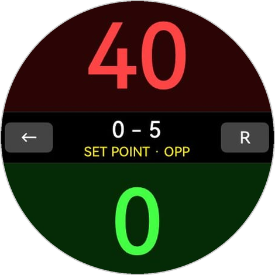
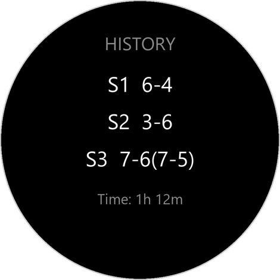
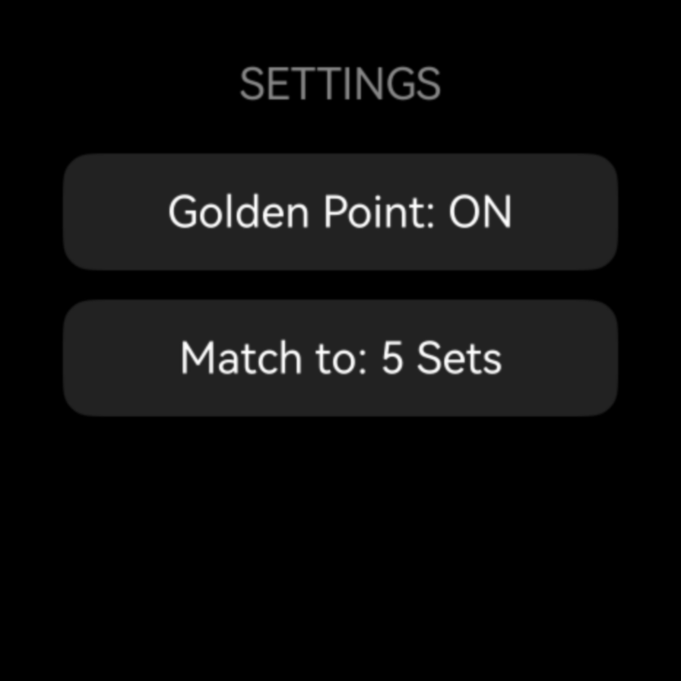

# Padel Counter para el Huawei Watch GT 6

[English](README.md) · [Català](README.ca.md) · **Español**

Un marcador de pádel para la muñeca. Toca la mitad de arriba cuando ganan los rivales y la de abajo cuando ganas tú. Sin móvil, sin cuenta y sin red.

Hecho para el Huawei Watch GT 6 (HarmonyOS, pantalla redonda de 466×466) con el framework JS Lite Wearable de HarmonyOS.

  
  
  

_Marcador: captura del reloj (v1.5), con un aviso amarillo de punto de set o de partido. Historial y Ajustes: imágenes generadas con el diseño de la app y datos de ejemplo._

## Funciones

- **Puntuación completa de pádel:** 0 / 15 / 30 / 40 / Ad, juegos, sets y tie-break al 6-6 (hasta 7, con dos puntos de ventaja).
- **Punto de oro** activado o desactivado.
- **Duración del partido:** 1, 3 o 5 sets.
- **Indicador de saque:** un punto amarillo muestra quién saca. Cambia cada juego y sigue la rotación del tie-break (tras el primer punto y luego cada dos).
- **Deshacer** los últimos 3 puntos. El historial de deshacer sobrevive si se cierra la app.
- **Historial del partido** con el resultado de cada set, con el detalle del tie-break (p. ej. `7-6(7-5)`), y la duración del partido.
- **Aviso de punto de set y de partido** en la barra central, con el lado que puede ganarlo.
- **Ahorro de batería:** la pantalla se atenúa tras 90 segundos sin tocarla y vuelve al brillo normal al tocarla.
- **Vibración:** una corta al ganar un juego y una larga al ganar un set o el partido. Se puede desactivar en Ajustes.
- **Reinicio seguro:** el botón `R` se pone rojo y pide `OK?`; un segundo toque antes de 3 segundos reinicia.
- **Mantiene la pantalla encendida** durante el partido y **guarda cada punto**, así que puedes continuar si el sistema cierra la app.

Desliza a la izquierda desde el marcador para ver el Historial y los Ajustes.

## Conviene saber

Si empiezas un entrenamiento en la app Deporte de Huawei, o recibes sus avisos de 30 min o 1 h, el sistema puede cerrar las apps de terceros. Una app de terceros no puede abrirse sola desde Deporte ni bloquear esos avisos. Padel Counter guarda el marcador tras cada punto, y al reabrirla el partido vuelve tal como estaba.

## Instalación

No hay versión en la tienda. Tienes que compilarla e instalarla tú:

1. Instala [DevEco Studio](https://developer.huawei.com/consumer/en/deveco-studio/) y abre esta carpeta.
2. En **File > Project Structure > Signing Configs**, genera tu propia firma de depuración (hace falta una cuenta de desarrollador de Huawei y el reloj registrado como dispositivo de pruebas).
3. Instala la app **DevEco Assistant** en el móvil y conecta el reloj a través de ella. Huawei lo hace bastante engorroso, así que cuenta con un rato.
4. Instala el `.hap` firmado en el reloj con DevEco Assistant: ejecuta el proyecto desde DevEco Studio, o copia el `.hap` compilado al móvil e instálalo desde la app.

Los archivos de firma (`.p12`, `.p7b`, `.cer`) no forman parte de este repositorio.

## Estructura del proyecto

Archivos

| Archivo | Qué hace |
| --- | --- |
| `entry/src/main/js/MainAbility/pages/index/index.js` | Reglas de puntuación, saque, deshacer, guardar y cargar |
| `.../index.hml` | Diseño: marcador, historial y ajustes |
| `.../index.css` | Estilos para la pantalla redonda de 466×466 |
| `entry/src/main/config.json` | Nombre del paquete, permisos y versión |

`@system.storage` en los relojes lite solo admite unos 128 bytes por valor, así que el partido se guarda en tres cadenas cortas separadas por comas (estado, historial de sets y pila de deshacer).

## Datos y licencias

- Código: [MIT](LICENSE).

## Versión

Actual: **1.5.2**

---

Developed by [Vlarac](https://github.com/Vlarac03)
