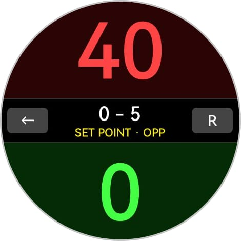
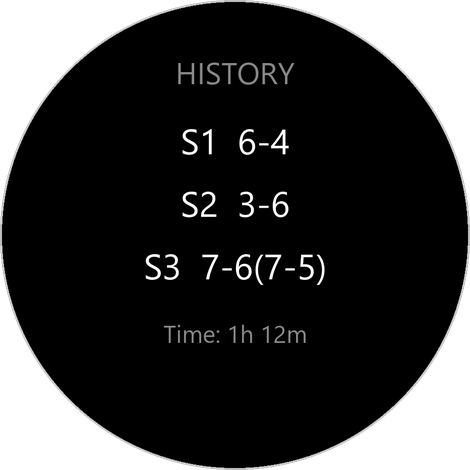
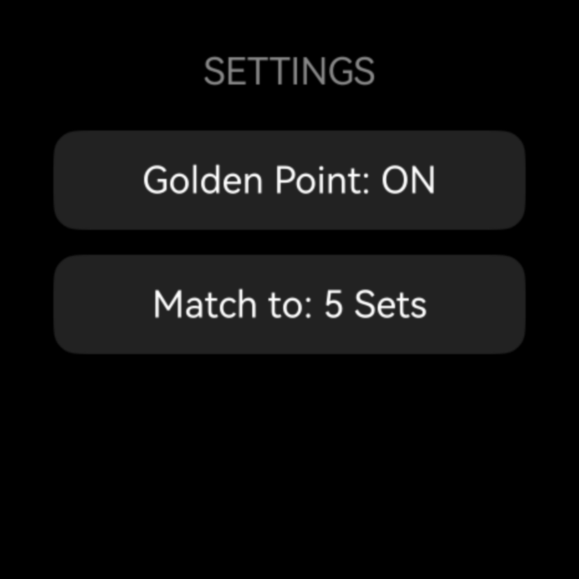

# Padel Counter for Huawei Watch GT 6

**English** · [Català](README.ca.md) · [Español](README.es.md)

A padel scoreboard for your wrist. Tap the top half of the screen when the opponents win a point, the bottom half when you do. No phone, no account, no network.

Built for the Huawei Watch GT 6 (HarmonyOS, 466×466 round display) with the HarmonyOS Lite Wearable JS framework.

  
  
  

_Screenshots are from v1.2. Since then the centre bar shows games and sets on two lines, and a yellow dot marks the serving side._

## Features

- **Full padel scoring:** 0 / 15 / 30 / 40 / Ad, games, sets and a tie-break at 6-6 (first to 7, two points clear).
- **Golden Point** on or off.
- **Match length:** 1, 3 or 5 sets.
- **Serve indicator:** a yellow dot shows who serves. It switches every game and follows the tie-break rotation (after the first point, then every two).
- **Undo** the last 3 points. The undo history survives the app being closed.
- **Match history** with the score of every set, tie-break detail included (e.g. `7-6(7-5)`), plus the match duration.
- **Set point / match point** alert in the centre bar, with the side that can win it.
- **Battery saver:** the screen dims after 90 seconds without touches and brightens again on touch.
- **Haptics:** a short buzz when a game is won, a long one for a set or the match. Can be turned off in Settings.
- **Safe reset:** the `R` button turns red and asks `OK?`; a second tap within 3 seconds resets.
- **Keeps the screen on** during the match and **saves every point**, so you can pick up where you left off if the system closes the app.

Swipe left from the scoreboard for History and Settings.

## Good to know

Starting a workout in Huawei's Sports app, or getting its 30 min / 1 h reminders, can make the system close third-party apps. A third-party app cannot start itself from Sports or block those pop-ups. Padel Counter stores the score after every point, so reopening it brings the match back as it was.

## Install

There is no store release. You build and install it yourself:

1. Install [DevEco Studio](https://developer.huawei.com/consumer/en/deveco-studio/) and open this folder.
2. In **File > Project Structure > Signing Configs**, generate your own debug signature (it needs a Huawei developer account and your watch registered as a test device).
3. Install the **DevEco Assistant** app on your phone and connect the watch through it. Huawei makes this step rather fiddly, so allow some time.
4. Install the signed `.hap` on the watch with DevEco Assistant: either run the project from DevEco Studio, or copy the built `.hap` to your phone and install it from the app.

The signing files (`.p12`, `.p7b`, `.cer`) are not part of this repository.

## Project structure

| File | What it does |
| --- | --- |
| `entry/src/main/js/MainAbility/pages/index/index.js` | Scoring rules, serve, undo, saving and loading |
| `.../index.hml` | Layout: scoreboard, history and settings pages |
| `.../index.css` | Styling for the round 466×466 display |
| `entry/src/main/config.json` | Bundle name, permissions, version |

`@system.storage` on lite wearables only holds about 128 bytes per value, so the match is saved as three short comma-separated strings (state, set history, undo stack).

## Version

Current: **1.5.2**

---

Developed by [Vlarac](https://github.com/Vlarac03)
